
<!-- projects:start -->
<a href="https://github.com/hfatih/ai-usage-hub"></a>
<a href="https://github.com/hfatih/samanyolu3d"></a>
<a href="https://github.com/hfatih/AutoAcceptLite"></a>
<a href="https://github.com/hfatih/blachole-simulation"></a>
<!-- projects:end -->

 

 

 






Every card here is an SVG drawn by <a href="build.py"><code>build.py</code></a> from the GitHub API and redrawn every three hours. Planets are repositories sized by their code, the moon is tonight's real phase, and in the sky a quiet day is a dim dot while a busy day is a bright star.
