
<a href="https://github.com/hfatih/macclone"></a><a href="https://github.com/hfatih/arduino-sensor-istasyonu"></a><a href="https://github.com/hfatih/AutoAcceptLite"></a><a href="https://github.com/hfatih/blachole-simulation"></a><a href="https://github.com/hfatih/ai-usage-hub"></a><a href="https://github.com/hfatih/samanyolu3d"></a><a href="https://github.com/hfatih/starlit-sync"></a><a href="https://github.com/hfatih/macclone"></a><a href="https://github.com/hfatih/StarlitDeck-Releases"></a><a href="https://github.com/hfatih/GalaxyV2"></a><a href="https://github.com/hfatih/arduino-sensor-istasyonu"></a><a href="https://github.com/hfatih/quantum-double-slit"></a><a href="https://github.com/hfatih/optical-bench"></a><a href="https://github.com/hfatih/AutoAcceptLite"></a><a href="https://github.com/hfatih/blachole-simulation"></a>

The sky, every card and every button are SVGs drawn by <a href="build.py"><code>build.py</code></a> from the GitHub API and redrawn every three hours: a new repository gets its own linked card, planet, radar blip and menu button without any editing.

## License

Project-owned code and original material in this revision are licensed under [GNU GPL v3.0](LICENSE) (GPL-3.0-only). Third-party code, fonts, imagery, data, and brand assets retain their own terms and attributions. [Previous license and copyright notice](licenses/previous-license.txt).
