  
  
  
  
  

Both posters and every button are SVGs drawn by <a href="build.py"><code>build.py</code></a> from the GitHub API and redrawn every three hours: a new repository gets its own card, planet, radar blip and button without any editing.
