
<a href="https://discordapp.com/users/268797596280160259"></a><a href="https://github.com/hfatih/glass-icons-pack-3"></a><a href="https://github.com/hfatih/glass-icons-pack-2"></a><a href="https://github.com/hfatih/glass-icons-pack-1"></a><a href="https://github.com/hfatih/pastel-icons-pack-3"></a><a href="https://github.com/hfatih/pastel-icons-pack-2"></a><a href="https://github.com/hfatih/pastel-icons-pack-1"></a><a href="https://github.com/hfatih/galaxy-icons-cosmic"></a><a href="https://github.com/hfatih/kawaii-icons-pack-2"></a><a href="https://github.com/hfatih/kawaii-icons-pack-1"></a><a href="https://github.com/hfatih/arduino-sensor-istasyonu"></a><a href="https://github.com/hfatih/quantum-double-slit"></a><a href="https://github.com/hfatih/optical-bench"></a><a href="https://github.com/hfatih/AutoAcceptLite"></a><a href="https://github.com/hfatih/ai-usage-hub"></a><a href="https://github.com/hfatih/samanyolu3d"></a><a href="https://github.com/hfatih/glass-icons-pack-3"></a><a href="https://github.com/hfatih/glass-icons-pack-2"></a><a href="https://github.com/hfatih/glass-icons-pack-1"></a><a href="https://github.com/hfatih/pastel-icons-pack-3"></a><a href="https://github.com/hfatih/pastel-icons-pack-2"></a><a href="https://github.com/hfatih/pastel-icons-pack-1"></a><a href="https://github.com/hfatih/galaxy-icons-cosmic"></a><a href="https://github.com/hfatih/kawaii-icons-pack-2"></a><a href="https://github.com/hfatih/kawaii-icons-pack-1"></a><a href="https://github.com/hfatih/arduino-sensor-istasyonu"></a><a href="https://github.com/hfatih/quantum-double-slit"></a><a href="https://github.com/hfatih/optical-bench"></a><a href="https://github.com/hfatih/AutoAcceptLite"></a><a href="https://github.com/hfatih/blachole-simulation"></a>

The sky, every card and every button are SVGs drawn by <a href="build.py"><code>build.py</code></a> from the GitHub API and redrawn every three hours: a new repository gets its own linked card, planet, radar blip and menu button without any editing.
